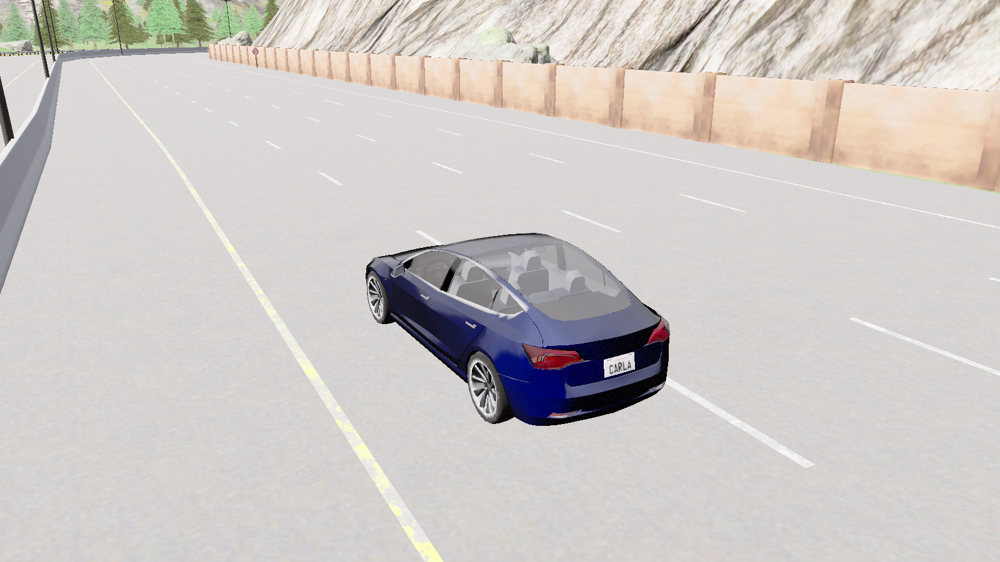

# CARLA 설명용 사진과 서버 종료 확인

작성일: 2026-11-02. 사용자가 촬영과 서버 종료 확인을 Codex에 직접 위임했다.

## 사진의 범위

완료된 본시험 로그에서 위치를 골라 새 CARLA 서버에 차량을 배치하고 RGB 카메라의 실제 출력을 PNG로 저장한다. 차량 물리는 끈 상태다. CAN 송수신, SUT와 adapter, 주행 또는 제동 성능 시험을 다시 실행하는 기능이 아니다. 사진만으로 주행 속도나 정지 성공을 판정하지 않는다.

각 사진의 속도, 제어와 프레임 설명은 **원본 로그**를 가리킨다. 새 촬영 프레임 및 시각은 별도로 기록한다. 카메라는 설명용 촬영에만 사용하며, 본시험의 동결 설정과 80회 결과를 변경하지 않는다. 배경 장애물과 차량의 기하 거리를 입력 거리값으로 해석하지 않는다.

사진을 논문에 넣을 때 공통 캡션: **“본시험 완료 후 기록된 차량 위치를 CARLA에 별도로 배치한 시각화 장면. 속도와 제동 상태는 해당 원본 로그의 값이며, 사진은 추가 주행 시험의 증거가 아니다.”**

## 고정한 대표 장면

모든 대상은 각 조합의 첫 반복 R01이다. 원본 호스트의 T0 기준 시각 또는 이미 판정된 정지 유지 완료 프레임으로 선정한다. 호스트 시각에서 시뮬레이션 시각을 빼지 않는다.

| 파일 | 원본 실행 | 선정 규칙 | 설명 |
| --- | --- | --- | --- |
| 01-normal.png | M-T-01-R01-A | 호스트 T0+2초 이후 첫 표본 | 정상 원거리 주행 위치 |
| 02-near-before.png | M-T-02-R01-B | 호스트 T0+12초 이후 첫 표본 | 근거리 요청 전 위치 |
| 03-near-stop.png | M-T-02-R01-B | R-07 정지 유지 완료 프레임 | 근거리 요청 후 정지 위치 |
| 04-timeout-stop.png | M-T-03-R01-B | R-07 정지 유지 완료 프레임 | 수신 중단 대응 후 정지 위치 |
| 05-repeat-A.png | M-T-04-R01-A | 호스트 T0+9초 이후 첫 표본 | 입력 복원 후 A의 계속 주행 위치 |
| 06-repeat-B.png | M-T-04-R01-B | 호스트 T0+9초 이후 첫 표본 | 입력 복원 후 B의 정지 잠금 위치 |

논문에는 전체 환경 사진 1개와 근거리 전후 또는 T-04 A/B 두 장을 우선 검토할 수 있다. 성능 차이의 주된 근거는 기존 결과표와 속도 그래프이며, 사진은 실행 환경을 설명하는 보조 자료다.

## 직접 재현 명령

이 명령은 **실제 CARLA 서버를 시작하고 종료한다.** 먼저 다른 CARLA 시험을 끝내고 포트 2000/2001이 비어 있는지 확인한다. vcan0 또는 sudo 설치는 필요 없다. 프로젝트의 기존 `.venv`와 CARLA 0.9.15 패키지, 원래 `runs/main-v1-20261101` 및 분석 manifest가 필요하다. 원시 로그는 GitHub에 모두 게시된 파일이 아니므로 현재 Linux 작업 폴더에서 실행한다.

```bash
cd /home/parkjuwon/can-stop-request-validation
bash tools/run_self_checks.sh check
ss -ltn 'sport = :2000 or sport = :2001'
.venv/bin/python -I tools/capture_carla_illustrations.py \
  --output-dir evidence/visualization/2026-11-02/capture-new \
  --start-owned-server
```

`capture-new`는 아직 존재하지 않는 새 폴더명이어야 한다. 기존 결과 폴더를 재사용하지 않는다. 도구는 다른 서버에 연결해 종료하지 않으며, 자신이 새로 시작한 전용 프로세스군에만 종료 신호를 보낸다. 실행 중 터미널을 닫지 않는다.

결과 위치:

- `captures/*.png`: CARLA가 직접 저장한 1600×900 사진.
- `plan.json`: 촬영 전에 고정한 원본 표본과 선정 규칙.
- `result.json`: 각 사진 SHA, 원본 실행/프레임/상태, 새 카메라 프레임, 설정 복구와 서버 종료 판정.
- `server.log`: 로컬 서버 출력. 큰 원시 로그 대신 필요한 종료 요약만 공유한다.

`capture_status=PASS`는 사진 저장과 촬영 자원 정리를 뜻한다. `server_shutdown.status=PASS`는 별도 조건이며, 종료코드 0, 치명 오류 표시 없음, 포트 해제와 직접 소유한 프로세스군의 소멸, 추가 강제 신호 없음이 모두 필요하다. 원본 해시도 촬영 전후 모두 PASS여야 한다. 종료코드 139 또는 Signal 11이 있으면 사진이 정상 저장됐더라도 서버 정상 종료로 표시하지 않는다.

## API 근거

촬영 구현은 [CARLA 0.9.15 RGB 카메라](https://carla.readthedocs.io/en/0.9.15/ref_sensors/#rgb-camera), [Python API](https://carla.readthedocs.io/en/0.9.15/python_api/), [offscreen 렌더링](https://carla.readthedocs.io/en/0.9.15/adv_rendering_options/)을 참고해 직접 작성했다. 외부 예제 코드는 복사하지 않았다. 화면 창이 뜨지 않는 offscreen 실행에서도 렌더링은 수행되므로 카메라 출력 파일을 검토한다.

## 이번 실행 결과

최종 [capture-04 결과](../evidence/visualization/2026-11-02/capture-04/result.json): **사진6개 저장PASS, 촬영 자원 정리PASS, 서버 종료NOT_NORMAL**. 사진은1600×900 PNG이며 원본 그대로다. Linux에서 실제 파일을 열어 차량과 도로가 보이는 것을 확인했다. Low 품질은 본시험과 같은 실행 옵션이며, 새 카메라는 촬영에만 추가했다.

| 원본 사진 | 원본 프레임 | 원본 호스트 T0 이후 s | 원본 속도 km/h | 원본 brake |
| --- | --- | --- | --- | --- |
| [01 정상 위치](../evidence/visualization/2026-11-02/capture-04/captures/01-normal.png) | 77293 | 2.044613 | 5.108814 | 0 |
| [02 근거리 요청 전](../evidence/visualization/2026-11-02/capture-04/captures/02-near-before.png) | 267619 | 12.010707 | 5.006477 | 0 |
| [03 근거리 정지 위치](../evidence/visualization/2026-11-02/capture-04/captures/03-near-stop.png) | 267650 | 13.562608 | 0 | 1 |
| [04 수신 중단 정지 위치](../evidence/visualization/2026-11-02/capture-04/captures/04-timeout-stop.png) | 346801 | 5.745019 | 0 | 1 |
| [05 반복 입력 A 위치](../evidence/visualization/2026-11-02/capture-04/captures/05-repeat-A.png) | 421603 | 9.008009 | 5.017231 | 0 |
| [06 반복 입력 B 위치](../evidence/visualization/2026-11-02/capture-04/captures/06-repeat-B.png) | 422285 | 9.000461 | 0 | 1 |

프레임과 속도는 **원래 로그**의 값이다. 모든 사진은 차량 물리를 끄고 위치만 재구성했으므로 사진 속 차량의 새로운 측정값이 아니다. 차량을 따라가는 같은 구도이므로 배경과 자세가 비슷하다. A/B의 성능 차이는 사진의 외형으로 판단하지 않고 원래 요청/속도 로그와 그래프로 판단한다.

원본 좌표를 API에 그대로 전달했지만 새 actor에서 읽은 표현에는 최대 약0.000031m 및0.000031도의 차이가 있었다. 이 차이도 별도 검토 파일에 보존했다. 사진의 위치를 원본과 수치적으로 완전히 동일하다고 주장하지 않으며 본시험의 판정 기준과 무관하다.

환경 설명에 사용할 첫 사진:



서버 SIGINT 종료에서 **Signal11 / 직접 프로세스 returncode=-11 / 셸 기준139**가 재현됐다. 종료코드0은 확인하지 못했으므로 정상 종료PASS로 바꾸지 않는다. 촬영 직후 카메라/차량 제거 및 설정 복구는PASS, 이후 서버 포트2000/2001 해제와 소유 프로세스군/GPU의CARLA잔존없음을 확인했다. SIGTERM/SIGKILL fallback은 사용하지 않았다. 종료 crash는 원인을 확정하지 못했고 OS/GPU 드라이버/패키지 변경으로 임의 수정하지 않았다.

실패 보존:

| 시도 | 촬영 결과 | 종료 | 보존/후속 |
| --- | --- | --- | --- |
| [capture-01](../evidence/visualization/2026-11-02/capture-01/result.json) | API준비120초초과, 사진0 | 130, Signal11미관측 | Epic시도. 원인 미확정. 이후Low/포트확인/새클라이언트재연결 사용 |
| [capture-02](../evidence/visualization/2026-11-02/capture-02/result.json) | 접지 위치 생성충돌, 사진0 | Signal11/139 | 최초 생성만높이고물리해제뒤원래위치배치. 원본좌표는수정안함 |
| [capture-03](../evidence/visualization/2026-11-02/capture-03/result.json) | 사진6, CLEANUP_ERROR | Signal11/139 | 제거전snapshot을읽는검사수정. 당시결과/소스/중복사진로컬보존 |
| [capture-04](../evidence/visualization/2026-11-02/capture-04/result.json) | 사진6/자원정리PASS | Signal11/139 | 최종배포사진. 신규본시험0회 |

이번Signal11재현3건과 기존4건을 합해 관측7건이다. 이전 결과를 덮어쓰지 않았고 각 실패 시점의 도구 사본과SHA도 보존했다. `capture-03/captures` 중복사진과서버원시log는로컬에유지하며, 최종사진/판정/작은종료요약을공유한다.

검증: `bash tools/run_self_checks.sh check` **297개OK**, 의존성/셸문법/공백PASS. 새12개검사는원본속도/표본선택/시계분리/출력및기존서버보호/재연결/생성여유/최신snapshot확인/종료crash보존을점검한다. [코드 검사](../evidence/visualization/2026-11-02/gate_checks.json), [최종 별도 검토](../evidence/visualization/2026-11-02/final_review.json). 원본741개 파일은촬영전후SHA일치이며, 결과80COMPLETE/70PASS/10FAIL은변경하지않았다.

원고 검토와 HWP 편집은 사용자가 Windows에서 진행한다. 사진을 쓰는 경우 위 공통 캡션을 붙이고, 정상 종료가 확인됐다는 문장은 넣지 않는다. 원래 본시험을 재실행할 필요는 없다.
