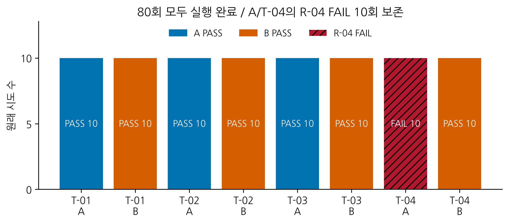
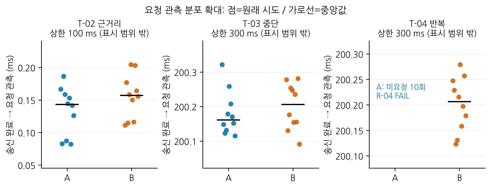
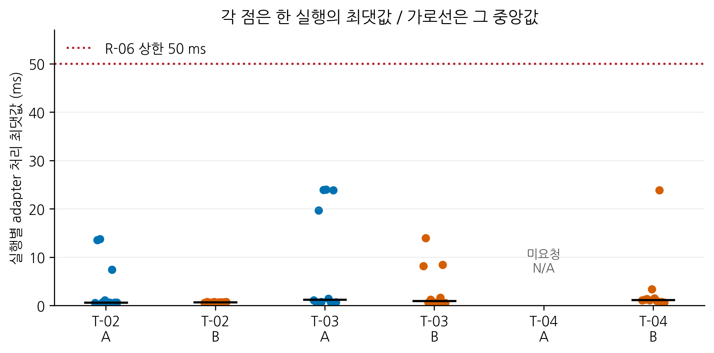
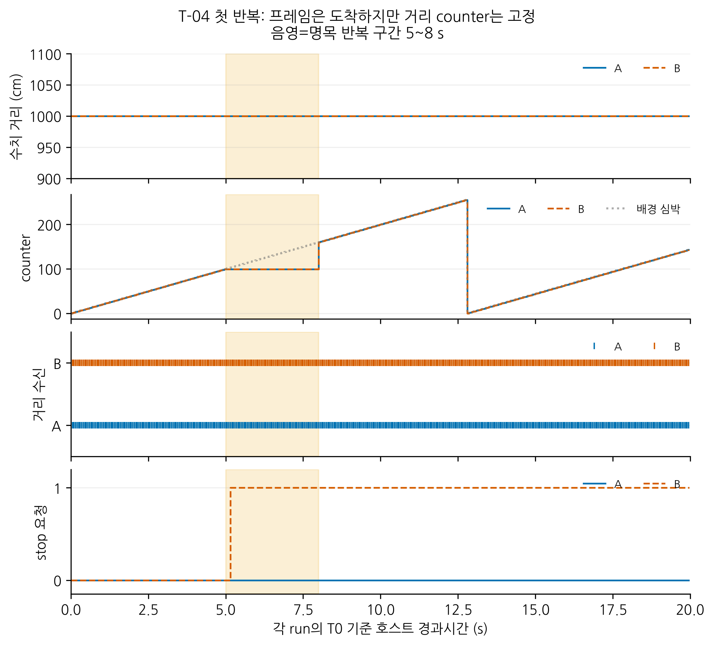
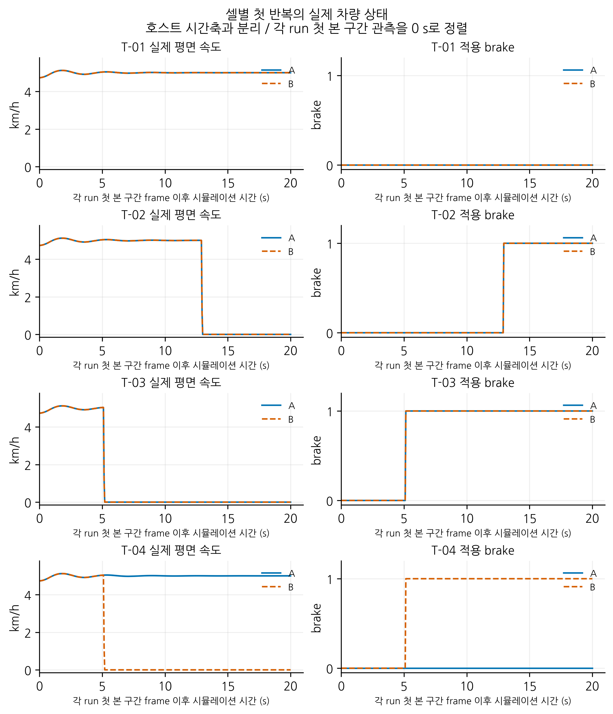

# 제4~5장 본문

작성 기준일: 2026-11-02. 원래80회 실제 기록과 오프라인 재판정 결과를 반영한 검토용 원고다. 그림은 시뮬레이터 화면 캡처가 아니라 저장 로그로 생성한 분석 그래프다. 기존5장/10개 절의 목차를 유지하며 HWP 페이지 수와 지도교수 승인은 별도로 확인한다.

# 제4장 시험 결과 및 분석

## 제1절 시나리오별 시험 결과

본시험에 앞서 vCAN 송수신, CARLA 단독 제어와 CAN 요청의 차량 적용을 단계적으로 확인하였다. G3 연결 기록[7]에 이어 거리 메시지 중단의 최소 연결, 메시지 수준 예비8개 조합과 별도 CARLA 개발 확인2개를 수행하였다. 준비 단계에서 발생한 최초 입력 시작 지연과 관측 누락 등의 실패는 해당 단계의 기록에 보존하였으며 본시험80회와 별도로 관리하였다. 본시험을 시작한 뒤에는 사전 배정한80개 ID와 동결한 코드/설정/입력 해시를 유지하였다.

80개 원래 시도는 모두 COMPLETE 상태로 끝났고, 각 실행의 차량 제거와 날씨/동기 설정 복구도 모두 PASS였다. 요구사항을 포함한 실행별 전체 판정은 PASS70회, FAIL10회였다. FAIL10회는 모두 A 방식의 T-04에서 정지 요청이 관측되지 않아 R-04를 충족하지 못한 경우였다. 입력/환경/증거 오류로 제외한 원래 시도나 성공 결과로 대체한 추가 실행은 없었다. 표 4-1과 그림 4-1은 시나리오별 결과를 나타낸다.

표 4-1. 원래 시도80회의 시나리오별 판정

| 시나리오 | A COMPLETE | A PASS/FAIL | B COMPLETE | B PASS/FAIL |
| --- | --- | --- | --- | --- |
| T-01 정상 원거리 | 10 | 10/0 | 10 | 10/0 |
| T-02 수치 근거리 진입 | 10 | 10/0 | 10 | 10/0 |
| T-03 거리 메시지 중단 | 10 | 10/0 | 10 | 10/0 |
| T-04 과거 프레임 반복 | 10 | 0/10 | 10 | 10/0 |
| 합계 | 40 | 30/10 | 40 | 40/0 |

그림 4-1. 시나리오별 원래10회 판정. FAIL도 완료한 원래 시도로 보존하였다. 색은 A/B, 빗금은 요구사항 미충족을 나타낸다.

T-01에서는 A/B 각각10회 모두 정상 거리 입력과 순번 진행을 확인하였고, 순번255→0 회전에서도 불필요한 정지 요청이 발생하지 않았다. 실제 차량은 본시험 구간에 계속 움직였으며 R-01과 R-05를 만족하였다. 정지 요청이 필요하지 않은 조건이므로 R-06과 R-07은 N/A로 분류하였다.

T-02에서는400개 거리 입력이 정해진 수식과 일치하였고, 최초200 cm 입력은 슬롯260이었다. A/B 각각10회 모두 근거리 요청의 관찰 창을 만족하였다. 요청을 받은 adapter의 호출 완료, 다음tick의 적용 제동, 실제 평면 속도의 정지 유지 조건도 충족하였다. T-03에서는 거리 메시지60개가 지정된 슬롯에서만 생략됐고 배경 심박400개는 유지되었다. 두 방식 모두 마지막 신규 거리 입력을 기준으로 요청하였으며, 거리 입력 복원 뒤에도 요청과 제동을 유지하였다.

T-04에서는 n=99의 거리 payload8바이트 전체를 n=100~159에서 반복하고 배경 순번은 계속 진행하였다. 두 방식에 주어진 거리 입력은 같은 규칙을 따랐다. A는10회 모두 정지 요청을 내지 않았고 차량은 계속 움직였다. B는10회 모두 순번 갱신 만료(reason3) 요청을 내고 실제 제동과 정지를 수행하였다. A의 R-04 실패는 본시험 전 정의한 공통 요구사항에 따른 판정이며, 예상한 동작이라는 이유로 합격으로 변경하지 않았다.

표 4-2는 요구사항별 결과를 나타낸다. N/A는 해당 실행에서 적용 시작 사건 등이 없어 평가하지 않은 경우이고, ‘시나리오 비해당’은 해당 시나리오의 확인 대상에 포함하지 않은 요구사항이다. 예를 들어 A/T-04는 요청이 없어 R-06~R-08이 N/A이며, 이를 제어 호출이나 차량 정지의 성공으로 세지 않았다. R-09는 미요청을 포함한 전체 관측 근거를 남긴 경우에도 평가할 수 있다.

표 4-2. 요구사항별 판정과 분모 구분

| 요구사항 | PASS | FAIL | N/A | 시나리오 비해당 |
| --- | --- | --- | --- | --- |
| R-01 | 20 | 0 | 0 | 60 |
| R-02 | 20 | 0 | 0 | 60 |
| R-03 | 20 | 0 | 0 | 60 |
| R-04 | 10 | 10 | 0 | 60 |
| R-05 | 20 | 0 | 0 | 60 |
| R-06 | 50 | 0 | 30 | 0 |
| R-07 | 50 | 0 | 30 | 0 |
| R-08 | 50 | 0 | 10 | 20 |
| R-09 | 80 | 0 | 0 | 0 |

요청 관측 시간은 표 4-3과 같다. 각 수치는 셀별10회 원래 시도의 최솟값/중앙값/최댓값이다. T-02는 최초 근거리 입력의 송신 완료, T-03과 T-04는 마지막 신규 거리 입력의 송신 완료를 기준으로 하였다. 실제 합격 판정에는 제3장의 송신 시작/완료 경계와 독립 관측 시각을 사용하였다. 관측되지 않은 A/T-04의 요청 시간을0 ms로 대체하지 않았다.

표 4-3. 입력 송신 완료부터 최초 요청 관측까지의 호스트 시간(ms)

| 조건 | 관측/원래 시도 | 최솟값 | 중앙값 | 최댓값 |
| --- | --- | --- | --- | --- |
| T-02 A | 10/10 | 0.081995 | 0.143105 | 0.186368 |
| T-02 B | 10/10 | 0.111276 | 0.157046 | 0.204434 |
| T-03 A | 10/10 | 200.114946 | 200.160886 | 200.321203 |
| T-03 B | 10/10 | 200.090836 | 200.205597 | 200.280861 |
| T-04 A | 0/10 | 미관측 | 미관측 | 미관측 |
| T-04 B | 10/10 | 200.122921 | 200.206309 | 200.278851 |

그림 4-2. 요청 관측 시간의 개별값과 중앙값. 세로축은 분포를 확대한 것으로 패널별 기점과 범위가 다르다. 판정 상한100/300 ms는 표시 범위 밖에 있으며 A/T-04 미관측10회를 수치점으로 표시하지 않았다. 수평 위치의 작은 이동은 점 겹침 방지용이다.

표 4-4는 각 실행 내부에서 측정한 adapter 처리 최댓값의 분포다. 실행마다 호출 수가 다르므로 모든 호출을 한꺼번에 모아 반복 수를 늘리지 않고, 원래 시도10개를 동일한 통계 단위로 사용하였다. 최초 제동 호출의 처리시간은 별도 CSV로 제공하며50개 정지 실행 전체에서0.209650~0.537127 ms였다. 반복 호출까지 포함한 최대 관측값은23.993759 ms로 연구용50 ms 한도 안에 있었다.

표 4-4. 실행별 adapter 처리 최댓값의 분포(ms)

| 조건 | 수치 확보/원래 시도 | 최솟값 | 중앙값 | 최댓값 |
| --- | --- | --- | --- | --- |
| T-02 A | 10/10 | 0.596793 | 0.665139 | 13.743319 |
| T-02 B | 10/10 | 0.544350 | 0.672446 | 0.785445 |
| T-03 A | 10/10 | 0.613861 | 1.260812 | 23.993759 |
| T-03 B | 10/10 | 0.570578 | 0.989059 | 13.941600 |
| T-04 A | 0/10 | N/A | N/A | N/A |
| T-04 B | 10/10 | 0.643260 | 1.179751 | 23.853492 |

그림 4-3. 각 실행의 adapter 처리 최댓값과 그 중앙값. 모든 개별 실행을 표시해20 ms대의 큰 관측값도 보존하였다. 점선은 R-06의50 ms 한도다.

실제 정지를 평가할 수 있었던 T-02의20회, T-03의20회와 B/T-04의10회, 총50회는 모두 R-07을 만족하였다. 각 실행에서 최초 제동 적용 다음frame부터 속도 조건을 만족하는11개 연속 표본을 확보하였고, 최초 적용부터11frame 간격인 명목0.55초까지 정지 유지 조건을 완료하였다. 이는 제동이 명목0.55초에 처음 시작됐다는 의미가 아니며, 연속0.5초 유지까지 포함한 완료 시간이다.0.05초 표본 간격보다 세밀한 정지시간 차이는 이 결과로 주장하지 않았다.

그림 4-4. T-04 첫 반복 A/B의 독립 CAN 관측. 거리 값은 일정하고 대상 프레임은 계속 수신되지만 명목5~8초의 거리counter는99에 고정된다. 배경 심박counter는 전진한다. B만 정지 요청을 내며 복원 뒤에도 유지한다. 모든 패널은 해당 run의 T0 기준 호스트 시간이다.

그림 4-5. 셀별 첫 반복의 실제 평면 속도와 적용 제동. 각 run 첫 본시험 관측frame의 시뮬레이션 시각을0으로 정렬하였다. 호스트 시간의 이상 구간을 이 축에 그대로 옮기지 않았다. 명령 속도 대신 CARLA 원시 속도벡터를 사용하였다.

그림 4-4와 그림 4-5의 대표 실행은 각 시나리오/방식의 R01로 고정하였다. 따라서 결과의 모양에 따라 유리한 실행을 골라 표시하지 않았다. 대표 그림이 나머지9회의 결과를 대신하지 않도록 표와 분포 그래프에 모든 원래 시도를 포함하였다. 그래프는 Matplotlib으로 생성하였다[9].

## 제2절 방식별 비교 및 한계

공통 요구사항에 대한 두 방식의 차이는 T-04에서 나타났다. A는 올바른 형식의 프레임이 도착할 때마다 마지막 수신 시각을 갱신하므로, 반복 입력의 도착이 지속되면 수신 타임아웃 조건이 성립하지 않았다. B는 수신 시각과 별도로 마지막 인정 순번의 갱신 시각을 관리하여 같은 입력에서도 순번 진행의 중단을 검출하였다. 이 결과는 프레임 수신과 신규 정보 갱신을 구분해야 한다는 설계상의 관측 한계를 실제 로그와 차량 상태로 확인한 것이다.

T-01에서는 두 방식 모두 정상적으로 전진하는 순번과255→0 회전을 허용하였다. T-02와 T-03에서도 두 방식은 해당 요청 및 차량 요구사항을 만족하였다. 따라서 본 결과는 B가 모든 상황에서 더 빠르거나 우수하다는 결론보다, 동일 프레임 반복이라는 지정 조건에서 감시 범위가 달라졌다는 결론을 뒷받침한다.

관측 시간의 작은 차이를 알고리즘의 순수 실행시간 차이로 해석하지 않았다. 예를 들어 같은 반복 번호의 B-A 요청 관측 시간 차이는 T-02에서-0.071864~0.121238 ms, T-03에서-0.103988~0.129137 ms로 양수와 음수 방향이 모두 나타났다. 호스트의 프로세스 스케줄링, 로그 기록과 RPC 대기 등이 포함되므로 별도 계측 없이 원인을 하나로 특정할 수 없다. 본시험의 송신 시작 일정 지연 최댓값은43.512419 ms, 기록된 tick 일정 지연 최댓값은22.936023 ms였다. 이 값을 주입한 메시지 고장으로 바꾸거나 큰 지연값을 제외하지 않았다.

실행 상태와 요구사항 판정을 분리한 점도 결과 해석에 중요하다. A/T-04의 COMPLETE와 R-04 FAIL은 동시에 성립한다. 요청이 없어 제동을 평가할 시작 사건이 없는 경우를 N/A로 유지함으로써 미검출을 빠른 응답이나 성공으로 잘못 집계하지 않았다. 원시 관측/제어 호출/차량 상태를 별도로 보관하여 입력 생성, 메시지 판단과 차량 반응의 어느 단계에서 차이가 생겼는지 추적할 수 있었다.

검증 범위에는 다음 한계가 있다. 첫째, 고정된 한 노트북/맵/차종과 네 수치 입력의 반복 결과이므로 도로/차종/GPU가 다른 환경의 성능이나 실차 고장 확률을 추정할 수 없다. 둘째, 입력은 실제 센서의 측정값이 아니므로 반사/인지 오차, 물리 장애물과의 안전거리 또는 충돌 회피를 검증하지 않았다. 셋째, vCAN으로 배선 고장, 전기적 오류, 물리CAN 중재나 ACK를 평가하지 않았다. 넷째, 오래된 측정값에 새로운 순번이 부여되면 본 순번 감시만으로 측정 최신성을 보장하지 못한다. 다섯째, 정지 관측은0.05초 간격의 시뮬레이션 표본이며 실차 제동 지연을 나타내지 않는다.

마지막으로 각 실행의 actor/날씨/설정 복구와 CARLA 서버 프로세스의 정상 종료를 구분하였다. 과거 연결 단계에서 Ctrl+C 종료 시 Signal11/139가 기록되었으며, 본시험 후 서버의 종료 결과는 작성 시점에 확인되지 않았다. 따라서 자원 정리PASS를 서버 종료 문제의 해결이나 장시간 무인 운용 안정성의 입증으로 표현하지 않았다.

# 제5장 결론

본 연구는 가상 CAN과 CARLA를 연결하여 저속 정지 요청 기능의 메시지 이상 대응을 요구사항에 따라 검증하는 환경을 구현하였다. 거리 입력, 독립 CAN 관측, adapter 제어 호출과 차량 상태를 분리하고, 사전에 정의한 네 시나리오에서 A/B 각각10회씩 총80개 원래 시도를 수행하였다. 모든 원래 시도는 기록 가능한 상태로 완료되었으며, A의 과거 프레임 반복 조건에서 발생한 R-04 FAIL10건도 결과에 포함하였다.

수신 타임아웃만 감시하는 방식과 순번 갱신 감시를 더한 방식은 정상 원거리, 수치 근거리 진입과 거리 메시지 중단에서 해당 요구사항을 충족하였다. 반면 동일한 과거 프레임이 반복되는 조건에서 A는 정지 요청을 내지 않았고 B는 순번 갱신 만료를 감지해 제동과 정지를 수행하였다. 연구 질문에 대한 답은 수신 도착만으로 프레임 진행 여부를 판별하는 데 한계가 있으며, 지정한 반복 조건에서는 순번 감시가 그 차이를 드러냈다는 것이다. 이는 모든 센서 고장이나 메시지 재생을 검출한다는 의미는 아니다.

본 연구의 의의는 새로운 차량 제어 알고리즘을 제안하는 데 있지 않고, 요구사항/고정 입력/독립 증거/판정을 연결하고 미충족과 결측을 보존하는 소규모 검증 절차를 구성한 데 있다. 후속 과제로는 검증 환경의 종료 안정성 확인, 다른 실행 환경과 명확히 버전 관리한 추가 조건의 검토가 있다. 실차 적용에는 실제 센서, 물리 통신과 제동 계통에 대한 별도 검증이 필요하다.

## 참고문헌 추가 항목

[9] J. D. Hunter, “Matplotlib: A 2D Graphics Environment,” Computing in Science & Engineering, vol. 9, no. 3, pp. 90-95, 2007, https://doi.org/10.1109/MCSE.2007.55. 공식 인용 안내: https://matplotlib.org/stable/project/citing.html (확인일: 2026.11.02).
