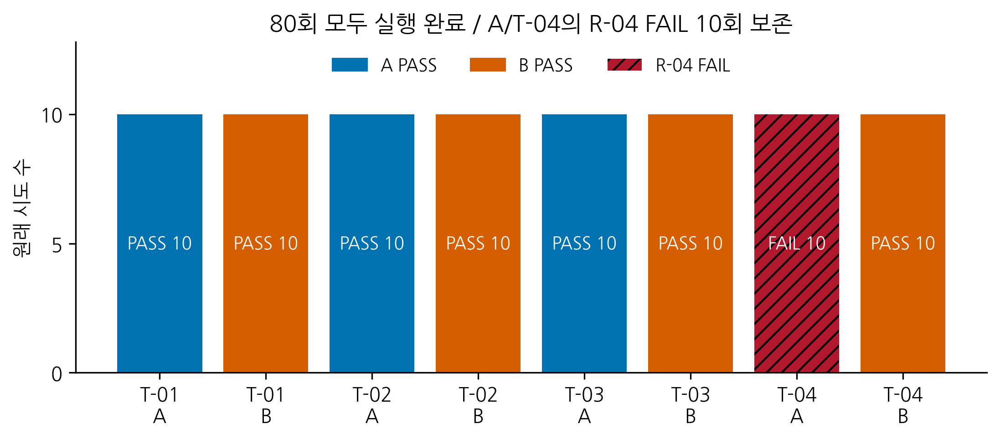
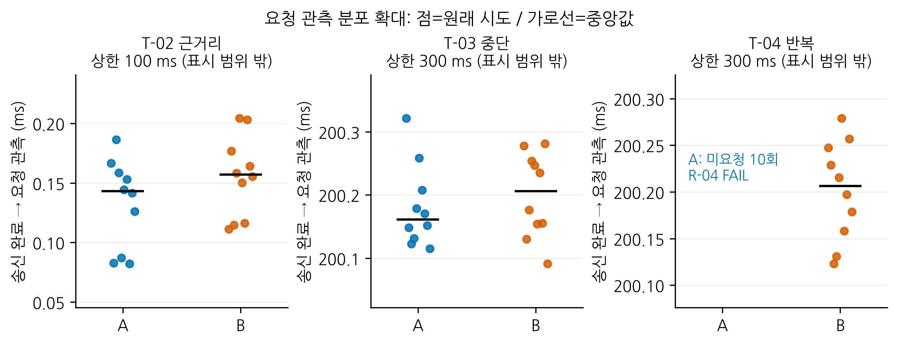
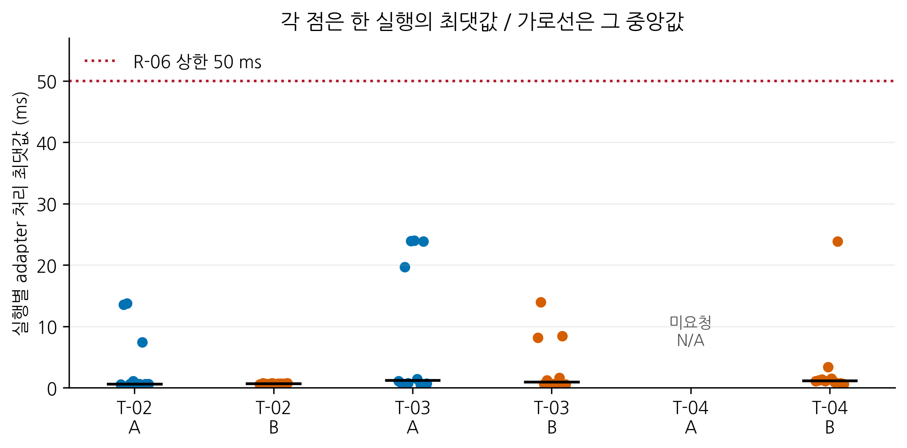
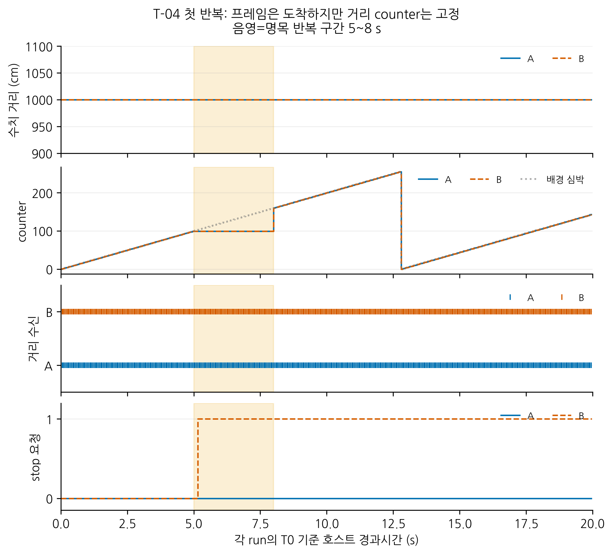
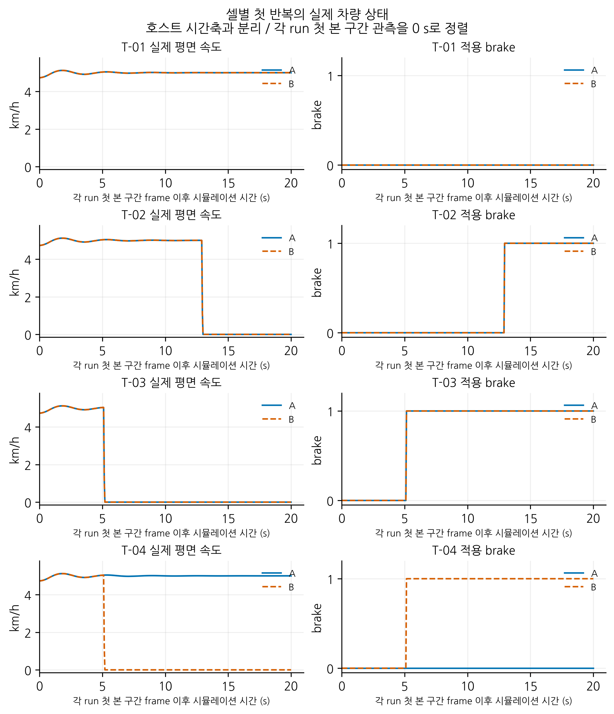

# 가상 CAN 환경에서 저속 주행 정지 요청 기능의 메시지 이상 대응 검증

2026-11-02 검토용 통합 원고. tools/build_thesis_draft.py로 생성했다. 최종5장 목차이며 HWP 분량/학교 양식과 지도교수 검토는 별도다.

# 국문초록

본 연구는 가상 CAN 환경에서 저속 주행 정지 요청 기능의 메시지 이상 대응을 요구사항에 따라 검증하였다. Linux vCAN과 CARLA0.9.15를 연결하고, 거리 메시지의 수신 타임아웃을 감시하는 방식 A와 순번 갱신 감시를 추가한 방식 B를 비교하였다. 입력은 실제 센서 대신 고정 수치 시퀀스로 생성하였다. 정상 원거리, 정상 근거리 진입, 거리 메시지 중단, 과거 프레임 반복의 네 시나리오에서 각 방식10회씩 총80개 원래 시도를 수행하였다. 입력과 요청의 독립 CAN 관측, adapter 호출, 실제 차량 속도와 적용 제동을 분리하여 기록하고 판정하였다.

80회 모두 실행과 자원 정리를 완료하였으며 실행별 전체 판정은 PASS70회와 FAIL10회였다. 정상 원거리, 근거리 진입과 거리 메시지 중단에서는 두 방식 모두 해당 요구사항을 충족하였다. 과거 프레임 반복에서는 A가10회 모두 정지 요청을 내지 않아 R-04를 충족하지 못했고, B는10회 모두 순번 갱신 만료를 감지해 제동과 정지를 수행하였다. 제동을 평가할 수 있었던50회는 호출 처리50 ms와 시뮬레이션2.0초 안의 정지 유지 기준을 만족하였다.

결과는 지정한 반복 조건에서 프레임의 도착과 순번 진행을 구분할 필요성을 보여준다. 본 연구의 기여는 요구사항에서 고정 입력, 독립 증거와 판정으로 이어지는 검증 절차와 실패를 보존한 비교 결과이다. 실제 센서 최신성, 물리CAN 고장이나 실차 제동 안전성을 입증한 결과로 확대하지 않는다.

핵심어: 차량 소프트웨어 검증, 요구사항 기반 시험, 가상 CAN, 순번 갱신 감시, CARLA

# 제1장 서론

## 제1절 연구 배경 및 필요성

차량의 전자제어 기능은 여러 제어 장치가 교환하는 상태 정보와 제어 데이터를 이용한다. CAN(Controller Area Network)은 이러한 장치 간 통신에 사용되며, Linux의 SocketCAN은 CAN 프레임을 소켓 기반으로 송수신할 수 있는 인터페이스를 제공한다[1]. 수신 데이터를 제어 판단에 사용하는 응용 프로그램에서는 프레임의 도착뿐 아니라 해당 정보가 정해진 규칙에 따라 갱신되는지도 고려해야 한다. AUTOSAR의 End-to-End 통신 보호 명세 역시 새 데이터가 없는 상태와 순번이 반복되는 상태를 구분하여 정의한다[2].

주기적으로 거리 정보를 받는 정지 요청 기능을 예로 들면, 대상 메시지가 일정 시간 동안 도착하지 않을 때 수신 타임아웃으로 이상을 판단할 수 있다. 그러나 수신할 때마다 기준 시각을 갱신하는 구현에서는 동일한 과거 프레임이 계속 도착할 경우 타임아웃이 발생하지 않을 수 있다. 따라서 메시지 중단과 동일 프레임 반복은 서로 다른 시험 조건으로 구분할 필요가 있다. 또한 거리 값이 일정하더라도 순번이 정상적으로 증가하는 입력은 정상일 수 있으므로, 값의 변화 유무만으로 정보 갱신을 판단해서는 안 된다.

이러한 기능을 평가할 때는 이상 조건에서 정지 요청이 발생하는지만 확인하는 것으로 충분하지 않다. 정상 입력에서 불필요한 요청이 발생하지 않는지, 생성된 요청이 수신 프로그램에 전달되는지, 제동 명령이 적용된 이후 차량 상태가 어떻게 변하는지를 함께 확인해야 한다. 요청 출력과 차량 정지를 구분하여 관측하면 문제가 발생한 단계를 로그에 근거해 분석할 수 있다.

Linux의 가상 CAN 인터페이스인 vCAN은 실제 CAN 제어기 없이 CAN 프레임을 송수신할 수 있다[1]. CARLA는 자율주행 시스템의 개발과 평가를 지원하는 공개 시뮬레이터이며[3], Python API를 통해 차량에 제어 명령을 전달하고 속도 상태를 조회할 수 있다[4]. 본 연구는 두 환경을 연결하여 메시지 이상에 대한 소프트웨어의 대응과 가상 차량의 정지 반응을 구분해 확인하는 검증 환경을 구현하고 시험하였다.

## 제2절 연구 목적 및 범위

본 연구의 목적은 가상 CAN 환경에서 저속 주행 정지 요청 기능의 메시지 이상 대응을 요구사항에 따라 비교할 수 있는 검증 절차를 구성하는 데 있다. 비교 대상은 유효 거리 메시지의 수신 시각을 감시하는 방식 A와, 동일한 수신 감시에 순번 갱신 감시를 추가한 방식 B이다. 두 방식에 같은 입력과 판정 기준을 적용하여 정상 조건의 동작과 메시지 이상에 대한 대응 차이를 비교하였다.

시험 조건은 정상 원거리, 정상 근거리 진입, 거리 메시지 중단, 동일 순번을 가진 과거 프레임 반복의 네 가지로 한정한다. 입력 생성기에서 사전에 정의한 거리 수치를 송신하고, 독립 관측기로 입력과 정지 요청을 기록한다. 정지 요청 수신 이후에는 CARLA 제동 명령과 차량의 관측 속도를 별도로 확인한다. 이를 통해 요구사항, 시험 조건, 관측 증거와 판정 결과를 연결하는 것을 목표로 한다.

연구 대상은 ECU의 일부 역할을 모사한 소프트웨어 프로그램이며 실제 ECU 펌웨어는 아니다. 거리 정보는 실제 센서나 CARLA 장애물로부터 측정하지 않고 시험용 수치 시퀀스로 생성한다. 따라서 검증 범위는 지정한 입력 조건에 대한 정지 요청과 시뮬레이션 차량의 반응이며, 실제 장애물과의 충돌 회피나 안전 정지 거리는 포함하지 않는다.

또한 vCAN 시험으로 실제 배선 고장, 전기적 오류, 물리 버스의 중재 성능이나 CAN ACK를 검증하지 않는다. 메시지 순번의 진행 역시 실제 센서 측정값의 최신성을 보장하는 근거로 확대하지 않는다. 본 연구의 의의는 새로운 제어 알고리즘이나 안전 인증을 제시하는 데 있지 않고, 제한된 메시지 이상 조건에서 요구사항을 독립된 관측 증거로 확인할 수 있는 재현 가능한 검증 사례를 구성하는 데 있다.

# 제2장 관련 기술

## 제1절 CAN 통신과 가상 검증 환경

CAN은 공유 버스에서 식별자에 따라 메시지를 구분하는 통신 방식이다. CAN ID는 메시지의 식별자로 사용되며, 특정 ECU에 개별적으로 데이터를 배달하는 목적지 주소와 구분된다. SocketCAN은 Linux의 네트워크 구조를 이용하여 CAN 장치와 응용 프로그램을 연결하며, 여러 소켓이 필요한 프레임을 수신할 수 있도록 한다[1].

vCAN은 이러한 소켓 인터페이스를 소프트웨어 환경에서 사용할 수 있게 하는 가상 네트워크 장치이다[1]. 본 연구에서는 거리 입력 생성기, 정지 요청 제어기와 수신 어댑터를 역할별 프로그램으로 구성하고 같은 vCAN 인터페이스에 연결하도록 설계하였다. 별도 관측기도 같은 버스를 수신하므로 송신 프로그램이나 제어기의 내부 판단에만 의존하지 않고 실제 수신 프레임을 기록할 수 있다.

CARLA는 가상 도로와 차량을 구성하고 외부 프로그램에서 차량 상태와 제어를 다룰 수 있는 시뮬레이터이다[3]. Python API의 차량 제어 기능과 속도 조회 기능은 명령 전달 이후 차량 반응을 관찰하는 데 활용할 수 있다[4]. 본 연구에서는 CAN 정지 요청을 해석하는 어댑터를 차량 제어에 연결하고, 이후 관측되는 속도로 정지 여부를 판단하도록 설계하였다.

CAN과 CARLA를 연결하는 참고 구현으로는 공개 프로젝트인 Yes, CARLA CAN을 조사하였다. 해당 프로젝트에는 SocketCAN 버스 구성, DBC 기반 메시지 해석과 CARLA 차량 제어 데이터 구성 경로가 포함되어 있다[5]. 본 연구는 이를 통신과 시뮬레이터 연결의 참고 사례로 활용하며, 본 연구에서 정한 거리 입력, 두 감시 방식, 정지 잠금과 독립 판정은 별도의 연구 설계로 구분한다. 공개 구현의 존재를 본 연구 환경의 실행 성공으로 대신하지 않고, 실제 연결 여부는 실행 기록으로 확인한다.

## 제2절 수신 타임아웃과 순번 갱신 감시

수신 타임아웃은 마지막으로 인정한 메시지의 수신 이후 경과시간이 허용 한도에 도달했는지 확인하는 방식이다. 대상 메시지가 주기적으로 전달된다는 조건에서 수신 중단을 판단하는 데 사용할 수 있다. 이때 다른 종류의 메시지가 도착하더라도 대상 메시지의 수신 시각을 갱신하지 않아야 감시 대상의 중단을 구분할 수 있다.

반면 동일한 과거 프레임이 계속 수신되는 경우에는 프레임 도착만으로 정보의 진행 여부를 판단하기 어렵다. 메시지에 포함된 순번을 이전 순번과 비교하면 신규 진행과 반복을 구분하는 단서를 얻을 수 있다. AUTOSAR E2E 명세에서도 수신 상태와 순번에 따라 반복, 신규 데이터 부재와 순서 이상을 구분한다[2]. 본 연구에서는 이러한 구분을 기술적 배경으로 참고하되 AUTOSAR E2E 프로파일 자체를 구현하거나 표준 적합성을 평가하지 않는다.

순번 감시에는 순환과 갱신 인정 범위의 정의가 필요하다. 유한한 비트 수로 표현한 순번은 최댓값 이후 처음 값으로 돌아오므로, 단순한 대소 비교만으로 정상 진행을 판단할 수 없다. 또한 반복되거나 인정 범위를 벗어난 순번을 기준값으로 바꾸면 후속 입력의 판단이 달라질 수 있다. 따라서 본 연구는 갱신을 인정하는 조건과 기준값을 유지하는 조건을 제3장에서 명시한다.

순번은 메시지 진행 여부를 판단하기 위한 정보이며 거리 값 자체의 변화와는 구분된다. 같은 거리라도 순번이 정상 진행하면 정상 입력으로 취급한다. 반대로 오래된 측정값에 새 순번이 붙는 경우는 본 연구의 감시만으로 검출할 수 없으므로 연구 범위에서 제외한다.

# 제3장 검증 시스템 및 시험 방법

## 제1절 요구사항 및 시스템 구성

검증 대상은 거리 정보를 받아 필요한 상황에서 정지 요청을 생성하는 프로그램이다. 검증 요구사항은 정상 입력의 동작, 메시지 이상 대응, 요청 적용, 차량 정지와 증거 기록으로 나누어 정의하였다. 표 3-1은 요구사항의 요약이며, 수치와 시간 경계는 이후 메시지 및 판정 규칙에서 정의한다.

표 3-1. 정지 요청 기능의 검증 요구사항

| ID | 요구사항 | 주된 확인 근거 |
| --- | --- | --- |
| R-01 | 정상 원거리 입력이 갱신되는 동안 불필요한 정지 요청을 내지 않는다. | 입력 및 정지 요청 관측 |
| R-02 | 유효 거리가 정지 기준에 도달하면 정해진 기한 안에 요청한다. | 근거리 입력과 최초 요청 시각 |
| R-03 | 거리 메시지 중단에 대응하며 다른 ID의 수신으로 만료를 연장하지 않는다. | 거리 및 배경 프레임과 요청 |
| R-04 | 동일 순번의 과거 프레임 반복에 정해진 기한 안에 대응한다. | 반복 payload와 최초 요청 |
| R-05 | 동일 거리의 정상 갱신과 순번 순환을 이상으로 오판하지 않는다. | 정상 순번 전이와 요청 |
| R-06 | 어댑터가 요청 수신 후 허용 시간 안에 제동 제어 호출을 완료한다. | 수신 및 호출 완료 시각 |
| R-07 | 제동 적용 후 관측 창 안에 정지 유지 조건을 만족한다. | 적용 프레임과 차량 속도 |
| R-08 | 정지 후 입력이 복원되어도 해당 시험 종료까지 요청과 제동을 유지한다. | 복원 이후 요청 및 차량 상태 |
| R-09 | 입력, 요청, 제어 호출과 차량 상태를 구분하여 증거를 남긴다. | 단계별 원시 로그 |

시스템은 거리 입력 생성기, 정지 요청 제어기, CARLA 어댑터, 시험 실행기와 독립 관측 및 판정기로 구성하였다. 입력 생성기는 지정된 거리와 순번을 송신하고 시험 실행기는 송신 중단 또는 과거 프레임 반복 구간을 제어한다. 제어기는 방식 A 또는 B 중 하나로 실행하며 CAN 정지 요청을 출력한다. 어댑터는 이를 수신하여 CARLA 차량의 제동 제어를 호출한다.

독립 관측기는 제어기와 별도로 버스의 입력 및 요청 프레임을 기록한다. 판정기는 이 자료와 입력 송신 기록, 어댑터 기록 및 차량 상태를 사전에 정한 요구사항과 비교하였다. 제어기의 내부 로그는 원인 분석에 사용하되, 제어기가 스스로 출력한 정상 또는 이상 상태만으로 합격을 판단하지 않았다.

방식 A와 B는 같은 실행에서 동시에 차량을 제어하지 않고 분리된 시험으로 비교한다. 차량 제어와 시뮬레이션 진행은 하나의 실행 주체가 관리하여 다른 제어 명령이나 중복 tick이 결과에 개입하지 않도록 한다. 공통 요구사항을 충족하지 못한 경우도 비교 결과로 남기며, 특정 방식이 모든 요구사항을 충족한다고 미리 가정하지 않는다.

## 제2절 메시지 규격 및 정지 요청 로직

메시지는 표준 11비트 ID를 사용하는 Classic CAN, DLC 8로 정의하였다. 다중 바이트 정수는 little-endian 방식으로 표현한다. ID와 신호 배치는 연구용 자체 규격이며 실제 차량의 DBC가 아니다. 표 3-2의 바이트 번호는 0부터 시작한다.

표 3-2. 연구용 CAN 메시지 규격

| ID 및 메시지 | 바이트 배치 | 송신 조건 |
| --- | --- | --- |
| 0x100 DistanceInput | 0~1: distance_cm(uint16), 2: counter(uint8), 3: valid(uint8), 4~7: run_token(uint32) | 정상 구간에서 50 ms 주기 |
| 0x101 BackgroundHeartbeat | 0: counter(uint8), 1~3: 0, 4~7: run_token(uint32) | 거리 메시지 이상 중에도 50 ms 주기 |
| 0x200 StopRequest | 0: stop(uint8), 1: reason(uint8), 2: counter(uint8), 3: 0, 4~7: run_token(uint32) | 상태 전이 즉시, 이후 50 ms 주기 |

distance_cm의 유효 범위는 0~10,000 cm이며 valid=1인 입력만 인정한다. ID, 길이, 현재 시험의 run_token과 디코딩 결과를 함께 확인하고 잘못된 입력은 거리 값과 감시 시각의 갱신에 사용하지 않는다. run_token은 다른 실행의 프레임을 구분하기 위한 식별값이며 보안 인증값은 아니다. 배경 심박은 버스의 다른 통신이 유지되는 상황을 만들기 위한 것으로 거리 메시지의 감시 시각을 갱신하지 않는다.

정지 요청의 stop은 정상 상태에서 0, 정지 상태에서 1로 정의한다. reason은 0을 NORMAL, 1을 NEAR_DISTANCE, 2를 RX_TIMEOUT, 3을 NO_SEQUENCE_PROGRESS, 4를 INIT_INHIBITED로 정의하였다. 최초 정지 원인은 잠금 해제 전까지 유지하며, 조건이 동시에 성립하면 수신 타임아웃, 순번 갱신 만료, 근거리 조건 순으로 기록한다.

두 방식은 유효 거리 200 cm 이하에서 정지 요청을 발생시키도록 구현하였다. 방식 A는 유효 거리 프레임마다 마지막 수신 시각과 사용할 거리 값을 갱신하며, 순번의 동일 여부는 판단하지 않는다. 마지막 유효 수신 이후 200 ms 이상 경과하면 수신 타임아웃으로 정지한다.

방식 B는 방식 A의 수신 감시에 마지막으로 인정한 순번의 갱신 시각을 추가한다. 새 순번을 c_new, 마지막으로 인정한 순번을 c_last라 할 때 차이는 식 (3-1)로 계산한다.

Δc = (c_new - c_last) mod 256                         (3-1)

최초 유효 프레임에서는 순번과 갱신 시각을 초기화한다. 이후 Δc가 1~127이면 진행으로 인정하고 거리, 기준 순번과 갱신 시각을 변경한다. Δc=0은 반복, 128~255는 허용 진행 범위 밖으로 분류하여 이 세 값을 변경하지 않는다. 따라서 255에서 0으로의 순환은 Δc=1로 인정된다. 유효 프레임의 도착 시각은 별도로 갱신하되 마지막 인정 순번의 갱신 이후 200 ms 이상 경과하면 정지 요청을 발생시킨다.

제어기 검사 주기는 10 ms로 정하였다. 입력 주기 50 ms, 만료 기준 200 ms와 거리 기준 200 cm는 이 연구의 비교를 위한 자체 설계값이며 법규나 양산차 안전 기준을 의미하지 않는다. 만료 기준은 명목 입력 주기의 네 배로 두어 반복적인 입력과 갱신 공백을 구분하도록 하였다.

기동 시에는 INIT_INHIBITED 상태에서 정지를 유지한다. 시험 실행기는 정상 입력 5개 이상, 준비 상태와 올바른 token을 확인한 후 명시적으로 동작 허용(arm)을 수행하였다. 이후 정지 조건이 성립하면 정지 잠금 상태로 전이하고 입력 복원만으로 해제하지 않는다. 다음 시험은 이전 상태를 초기화한 새 실행으로 시작한다. 기동과 준비를 30초 안에 마치지 못하면 원인을 기록하고 해당 시도를 종료한다.

정상 주행에는 CARLA 내장 Ackermann 속도 제어를 사용한다. 정지 잠금 이후에는 이 제어 경로를 중지하여 제동을 덮어쓰지 않도록 한다. 어댑터는 정지 요청 이후 가속 입력을 0, 제동 입력을 1, 조향 입력을 0으로 적용하고 주차 제동은 사용하지 않도록 한다. 정상 요청의 복원은 재출발 명령으로 해석하지 않는다. 차량에는 한 경로에서만 제어를 적용하고 자동 주행과 키보드 제어가 이를 덮어쓰지 않도록 한다.

## 제3절 시험 환경 및 시나리오

실행 환경은 Ubuntu와 별도의 Python 가상환경, Linux vCAN, CARLA로 구성하였다. 표 3-3의 운영체제/GPU 항목은 구축 점검 기록[6], 라이브러리는 고정 환경 기록을 근거로 한다. 본시험80개 metadata에서 CARLA 서버/client 0.9.15, Town04, Model3와 고정 설정의 일치를 확인하였다. 분석과 그래프 생성은 실험 환경을 보존한 별도 Python 3.10 환경에서 수행하였다.

표 3-3. 구축 기록과 본시험 실행 조건

| 항목 | 확인한 환경 |
| --- | --- |
| 운영체제 및 커널 | Ubuntu 22.04.5, Linux 6.8.0-138 |
| GPU 및 드라이버 | NVIDIA RTX 4060 Laptop, 약 8 GB VRAM, 드라이버 570.211.01 |
| Python | 별도 가상환경의 Python 3.10.12 |
| CAN 인터페이스 및 라이브러리 | SocketCAN vcan0, python-can 4.6.1, cantools 40.7.1 |
| CARLA | 서버 및 Python client 0.9.15 |
| 가상 도로와 차량 | Town04, vehicle.tesla.model3, ClearNoon |
| 시뮬레이션 진행 | 동기 모드, 고정 시간 간격 0.05 s |
| 본시험 시작 위치 | Town04 spawn index 143, 모든 A/B 시도에 고정 |
| 제어 적용 | sticky_control=true, batch 제동 응답 확인 후 단일 tick |
| 그래프 도구 | 별도 분석 환경의 Matplotlib 3.10.8 |

본시험에서는 다른 차량과 보행자가 없는 최소100 m의 평탄한 직선 구간을 확인하고 spawn index 143을 고정하였다. 시작 좌표와 차량 물리/Ackermann 설정을 사전에 기록하고80개 시도에 공통 적용하였다. 실제 위치는 각 frame에서 관찰하여 구간 이탈을 점검하였다. 차량 제거와 날씨/동기 설정 복구는 각 실행의 정리 기록으로 확인하였다. 서버 프로세스의 정상 종료는 이 정리 판정과 별도이며 본문 작성 시점에는 확인되지 않았다.

CARLA의 동기 모드에서는 client의 tick에 따라 시뮬레이션이 진행된다. 고정 시간 간격은 시뮬레이션 내부의 시간 진행을 정하며 호스트에서 같은 시간이 경과함을 보장하지 않는다[8]. 이에 따라 메시지 송수신과 타임아웃은 호스트의 단조 증가 시계인 monotonic_ns를 사용하고, 차량 정지 관측에는 CARLA 프레임과 시뮬레이션 시간을 사용한다. 두 시계의 시각을 직접 빼서 지연을 계산하지 않는다.

각 시험에서는 arm 이후 실제 관측 속도가 5.0±0.5 km/h 범위에서 1.0초 이상 유지되는 것을 확인하였다. 이 조건을 만족한 뒤 다음 정상 counter=0 프레임의 송신 시작을 본시험의 t0로 정하였다. 준비 중에도 입력과 감시는 유지하고 순번을 임의로 되돌리지 않았다.

입력 구간은 호스트 시간 20초이며 50 ms 간격의 400개 슬롯으로 구성한다. 슬롯 번호 n은 0~399이고 정상 순번은 n mod 256이다. 지연된 과거 슬롯을 한꺼번에 송신하지 않고 실제 송신 시작과 성공 반환 시각 및 지연을 기록한다. 거리 입력은 사전에 정한 수치이며 CARLA 차량과 실제 장애물 사이의 거리가 아니다. 입력 구간이 끝났을 때 이미 관찰한 정지 요청의 차량 판정 창이 완료되지 않았다면 그 창까지만 관측을 연장한다. 입력 종료 이후 새로 발생한 타임아웃은 본시험의 신규 사건으로 계산하지 않는다.

표 3-4. 본시험 시나리오

| ID | 입력 및 이상 조건 | 확인할 요구사항 |
| --- | --- | --- |
| T-01 정상 원거리 | 전 구간 1,000 cm, valid=1, 정상 순번 진행과 순환 | 불필요한 정지 요청 없음, R-01, R-05, R-09 |
| T-02 정상 근거리 진입 | n=0~100에서 1,000 cm, n=101부터 슬롯마다 5 cm 감소시키되 최솟값 50 cm | 근거리 요청, 제동, 정지와 유지, R-02, R-06~R-09 |
| T-03 거리 메시지 중단 | 거리 1,000 cm, n=100~159에서 0x100만 생략하고 n=160부터 복원 | 중단 대응과 복원 후 잠금, R-03, R-06~R-09 |
| T-04 과거 프레임 반복 | 거리 1,000 cm, n=100~159에서 n=99의 8바이트 payload 전체를 반복하고 n=160부터 정상 복원 | 반복 대응과 복원 후 잠금, R-04, R-06~R-09 |

T-02의 n=100~399 구간은 distance_cm=max(50, 1000-5(n-100))으로 정의하였다. 최초 정지 기준 입력은 n=260, 명목 시간 13.0초에 해당하지만 실제 판정에서는 그 프레임의 송신 기록을 사용한다.

T-03과 T-04의 이상 구간은 명목 5~8초이다. 두 조건 모두 n=99가 이상 전 마지막 신규 거리 프레임이다. T-04는 그 프레임의 거리, 순번, 유효성 및 token을 포함한 전체 payload를 그대로 반복하므로 프레임 수신이 지속되는 상태를 만든다. 배경 심박은 두 이상 조건에서도 계속 송신한다.

T-04의 공통 목표 역시 정해진 시간 안의 정지 요청이다. 다만 방식 A는 반복 수신으로 수신 시각이 갱신되므로 이를 충족하지 못할 수 있다. 이는 설계에서 예상하는 차이이며, 실제 충족 여부는 기록된 프레임과 판정 기준으로 결정한다.

본시험은 네 시나리오와 두 방식의 조합별로10회씩 사전 배정한 총80개 원래 시도를 실행하였다. 홀수 반복은 A 다음 B, 짝수는 B 다음 A 순서였으며 입력 및 설정을 동일하게 유지하였다. 실행 token과 actor ID 차이는 식별값으로 기록하였다. 원래 시도의 실패도 포함하였으며 성공10회를 채우기 위한 대체 실행은 수행하지 않았다.

본시험에 앞서 CARLA 없는 독립 vCAN에서 네 시나리오와 두 방식의 예비8개 조합을 실행하였다. 이어 B/T-04와 A/T-01의 CARLA 개발 확인을 별도로 수행한 뒤 본시험을 시작하였다. 예비시험, 연결 확인과 개발 확인은80회 본시험에 포함하지 않았다.

## 제4절 평가 지표 및 판정 방법

판정은 본시험 t0 이후의 입력 구간을 대상으로 하며, 기동 억제와 준비 단계의 정지 요청은 구분하여 기록한다. 입력 송신, 독립 요청 관찰, 어댑터 처리와 차량 상태를 분리하여 평가하도록 설계하였다. 입력 생성기는 송신 호출 직전 시각 s_begin과 성공 반환 직후 시각 s_done을 기록한다. 독립 관측기는 최초 유효 정지 요청의 관찰 시각 q_obs를 기록하고, 어댑터는 해당 요청의 수신 시각 a_rx와 제동 호출 완료 시각 a_done을 기록한다.

표 3-5. 주요 평가 지표와 판정 기준

| 평가 대상 | 기준 사건 | 판정 기준 |
| --- | --- | --- |
| 근거리 정지 요청 | 최초 유효 distance_cm≤200 프레임의 송신 구간 | 본시험 구간의 s_begin 이전 요청 없음, q_obs≤s_done+100 ms |
| 메시지 이상 정지 요청 | n=99 마지막 신규 프레임의 송신 구간 | s_begin+200 ms≤q_obs≤s_done+300 ms |
| 어댑터 처리 | 같은 요청의 수신과 제동 호출 완료 | a_done-a_rx≤50 ms |
| 차량 정지 | 최초 제동 적용 확인 프레임 | 시뮬레이션 2.0초 관측 창 안에서 평면 속도 0.1 m/s 이하를 연속 0.5초 이상 유지 |

메시지 이상 판정의 기준은 이상 주입 시작 시각이 아니라 마지막 신규 프레임이다. 명목 일정에서 해당 프레임은 4.95초에 송신되므로 200 ms 만료는 약 5.15초에 해당한다. 실제 판정에서는 명목 시각 대신 실제 송신 호출 경계를 사용하며, 너무 이른 요청, 늦은 요청과 요청 미관찰을 구분한다. 이는 응용 프로그램의 관찰 경계이며 물리 CAN 전송 시각의 측정이 아니다.

어댑터의 제동 호출 완료만으로 차량에 제동이 적용되었다고 간주하지 않는다. 이후 CARLA tick에서 적용 제어를 확인한 최초 프레임을 기준으로 차량 상태를 평가한다. 관측 속도는 CARLA의 get_velocity()가 제공하는 속도벡터를 이용하며[4], 평면 속도는 식 (3-2)로 계산한다.

v = sqrt(v_x² + v_y²)                                (3-2)

v_x와 v_y의 단위는 m/s이다. 목표 속도나 제어 명령을 관측 속도의 대체값으로 사용하지 않는다. 0.05초 고정 간격에서 0.5초의 유지 조건은 10개 프레임 간격에 해당하므로 최소 11개의 연속 표본이 필요하다. 적용 프레임부터 명목 2.0초인 40개 프레임 간격 안에 유지 조건이 완료되는지 확인하고 중간 프레임 누락도 점검한다.

입력이 복원된 이후에는 최초 정지 원인과 요청 및 제동이 유지되는지를 확인한다. 요청이 없어 제동 적용 프레임이 존재하지 않는 경우에는 차량 정지 지표의 계산 불가와 상류의 요청 실패를 함께 기록한다. 시험 종료를 위한 별도 정지 명령은 본시험 기능의 성공 근거에서 제외한다.

요구사항별 결과는 PASS, FAIL, N/A와 INCONCLUSIVE로 구분한다. 이와 별도로 실행 상태는 COMPLETE, SUT_ERROR, ENV_ERROR, EVIDENCE_ERROR와 INPUT_ERROR로 기록하도록 정의하였다. 요구사항이 실패해도 입력과 로그가 정상적으로 확보되었다면 실행 상태는 COMPLETE일 수 있다. 접속이나 초기 속도 확보에 실패한 경우와, 제어기가 정해진 기한을 지키지 못한 경우를 같은 오류로 취급하지 않는다.

호스트 스케줄링 지연에 따른 요청 기한 초과는 임의로 환경 오류로 바꿔 제외하지 않는다. CARLA 지연으로 차량 관측 자료가 충분하지 않으면 가능한 메시지 판정은 유지하고 차량 판정의 불확실성을 별도로 표시한다. 이미 확인된 요구사항 실패도 증거 일부가 부족하다는 이유로 지우지 않는다.

각 시험의 commit, 설정과 입력 자료의 해시, 식별값 및 실행 조건을 metadata로 남기고 입력, CAN 관측, 제어기, 어댑터와 차량 상태의 원시 로그를 구분하여 저장하였다. 오프라인 분석에서는 동결한 독립 판정기로80개 원시 기록을 재계산하여 저장 판정과의 일치를 확인하였다. 통계 단위는 각 원래 시도이며 셀별10개 값의 최솟값, 중앙값과 최댓값을 산출하였다. adapter 지표는 최초 호출 시간과 실행 내부 최댓값의 분포를 구분하였고 호출 수가 많은 실행을 더 큰 가중치로 처리하지 않았다.

미요청과 적용 시작 frame이 없는 경우 수치를0으로 바꾸지 않았다. 정상 비정지의 미적용, 요청이 필요한 조건의 미요청, 시나리오에서 다루지 않은 요구사항을 구분하였다. 그래프의 대표 시계열은 결과의 모양으로 선택하지 않고 각 셀의 첫 반복으로 고정하였으며, 분포 그래프에는10회 반복값을 모두 표시하였다. 호스트 시간과 CARLA 시뮬레이션 시간은 별도 축으로 표시하였다. 동일 환경의 반복10회로 고장 확률이나 통계적 성능 우위를 추정하지 않았다.

# 제4장 시험 결과 및 분석

## 제1절 시나리오별 시험 결과

본시험에 앞서 vCAN 송수신, CARLA 단독 제어와 CAN 요청의 차량 적용을 단계적으로 확인하였다. G3 연결 기록[7]에 이어 거리 메시지 중단의 최소 연결, 메시지 수준 예비8개 조합과 별도 CARLA 개발 확인2개를 수행하였다. 준비 단계에서 발생한 최초 입력 시작 지연과 관측 누락 등의 실패는 해당 단계의 기록에 보존하였으며 본시험80회와 별도로 관리하였다. 본시험을 시작한 뒤에는 사전 배정한80개 ID와 동결한 코드/설정/입력 해시를 유지하였다.

80개 원래 시도는 모두 COMPLETE 상태로 끝났고, 각 실행의 차량 제거와 날씨/동기 설정 복구도 모두 PASS였다. 요구사항을 포함한 실행별 전체 판정은 PASS70회, FAIL10회였다. FAIL10회는 모두 A 방식의 T-04에서 정지 요청이 관측되지 않아 R-04를 충족하지 못한 경우였다. 입력/환경/증거 오류로 제외한 원래 시도나 성공 결과로 대체한 추가 실행은 없었다. 표 4-1과 그림 4-1은 시나리오별 결과를 나타낸다.

표 4-1. 원래 시도80회의 시나리오별 판정

| 시나리오 | A COMPLETE | A PASS/FAIL | B COMPLETE | B PASS/FAIL |
| --- | --- | --- | --- | --- |
| T-01 정상 원거리 | 10 | 10/0 | 10 | 10/0 |
| T-02 수치 근거리 진입 | 10 | 10/0 | 10 | 10/0 |
| T-03 거리 메시지 중단 | 10 | 10/0 | 10 | 10/0 |
| T-04 과거 프레임 반복 | 10 | 0/10 | 10 | 10/0 |
| 합계 | 40 | 30/10 | 40 | 40/0 |

그림 4-1. 시나리오별 원래10회 판정. FAIL도 완료한 원래 시도로 보존하였다. 색은 A/B, 빗금은 요구사항 미충족을 나타낸다.

T-01에서는 A/B 각각10회 모두 정상 거리 입력과 순번 진행을 확인하였고, 순번255→0 회전에서도 불필요한 정지 요청이 발생하지 않았다. 실제 차량은 본시험 구간에 계속 움직였으며 R-01과 R-05를 만족하였다. 정지 요청이 필요하지 않은 조건이므로 R-06과 R-07은 N/A로 분류하였다.

T-02에서는400개 거리 입력이 정해진 수식과 일치하였고, 최초200 cm 입력은 슬롯260이었다. A/B 각각10회 모두 근거리 요청의 관찰 창을 만족하였다. 요청을 받은 adapter의 호출 완료, 다음tick의 적용 제동, 실제 평면 속도의 정지 유지 조건도 충족하였다. T-03에서는 거리 메시지60개가 지정된 슬롯에서만 생략됐고 배경 심박400개는 유지되었다. 두 방식 모두 마지막 신규 거리 입력을 기준으로 요청하였으며, 거리 입력 복원 뒤에도 요청과 제동을 유지하였다.

T-04에서는 n=99의 거리 payload8바이트 전체를 n=100~159에서 반복하고 배경 순번은 계속 진행하였다. 두 방식에 주어진 거리 입력은 같은 규칙을 따랐다. A는10회 모두 정지 요청을 내지 않았고 차량은 계속 움직였다. B는10회 모두 순번 갱신 만료(reason3) 요청을 내고 실제 제동과 정지를 수행하였다. A의 R-04 실패는 본시험 전 정의한 공통 요구사항에 따른 판정이며, 예상한 동작이라는 이유로 합격으로 변경하지 않았다.

표 4-2는 요구사항별 결과를 나타낸다. N/A는 해당 실행에서 적용 시작 사건 등이 없어 평가하지 않은 경우이고, ‘시나리오 비해당’은 해당 시나리오의 확인 대상에 포함하지 않은 요구사항이다. 예를 들어 A/T-04는 요청이 없어 R-06~R-08이 N/A이며, 이를 제어 호출이나 차량 정지의 성공으로 세지 않았다. R-09는 미요청을 포함한 전체 관측 근거를 남긴 경우에도 평가할 수 있다.

표 4-2. 요구사항별 판정과 분모 구분

| 요구사항 | PASS | FAIL | N/A | 시나리오 비해당 |
| --- | --- | --- | --- | --- |
| R-01 | 20 | 0 | 0 | 60 |
| R-02 | 20 | 0 | 0 | 60 |
| R-03 | 20 | 0 | 0 | 60 |
| R-04 | 10 | 10 | 0 | 60 |
| R-05 | 20 | 0 | 0 | 60 |
| R-06 | 50 | 0 | 30 | 0 |
| R-07 | 50 | 0 | 30 | 0 |
| R-08 | 50 | 0 | 10 | 20 |
| R-09 | 80 | 0 | 0 | 0 |

요청 관측 시간은 표 4-3과 같다. 각 수치는 셀별10회 원래 시도의 최솟값/중앙값/최댓값이다. T-02는 최초 근거리 입력의 송신 완료, T-03과 T-04는 마지막 신규 거리 입력의 송신 완료를 기준으로 하였다. 실제 합격 판정에는 제3장의 송신 시작/완료 경계와 독립 관측 시각을 사용하였다. 관측되지 않은 A/T-04의 요청 시간을0 ms로 대체하지 않았다.

표 4-3. 입력 송신 완료부터 최초 요청 관측까지의 호스트 시간(ms)

| 조건 | 관측/원래 시도 | 최솟값 | 중앙값 | 최댓값 |
| --- | --- | --- | --- | --- |
| T-02 A | 10/10 | 0.081995 | 0.143105 | 0.186368 |
| T-02 B | 10/10 | 0.111276 | 0.157046 | 0.204434 |
| T-03 A | 10/10 | 200.114946 | 200.160886 | 200.321203 |
| T-03 B | 10/10 | 200.090836 | 200.205597 | 200.280861 |
| T-04 A | 0/10 | 미관측 | 미관측 | 미관측 |
| T-04 B | 10/10 | 200.122921 | 200.206309 | 200.278851 |

그림 4-2. 요청 관측 시간의 개별값과 중앙값. 세로축은 분포를 확대한 것으로 패널별 기점과 범위가 다르다. 판정 상한100/300 ms는 표시 범위 밖에 있으며 A/T-04 미관측10회를 수치점으로 표시하지 않았다. 수평 위치의 작은 이동은 점 겹침 방지용이다.

표 4-4는 각 실행 내부에서 측정한 adapter 처리 최댓값의 분포다. 실행마다 호출 수가 다르므로 모든 호출을 한꺼번에 모아 반복 수를 늘리지 않고, 원래 시도10개를 동일한 통계 단위로 사용하였다. 최초 제동 호출의 처리시간은 별도 CSV로 제공하며50개 정지 실행 전체에서0.209650~0.537127 ms였다. 반복 호출까지 포함한 최대 관측값은23.993759 ms로 연구용50 ms 한도 안에 있었다.

표 4-4. 실행별 adapter 처리 최댓값의 분포(ms)

| 조건 | 수치 확보/원래 시도 | 최솟값 | 중앙값 | 최댓값 |
| --- | --- | --- | --- | --- |
| T-02 A | 10/10 | 0.596793 | 0.665139 | 13.743319 |
| T-02 B | 10/10 | 0.544350 | 0.672446 | 0.785445 |
| T-03 A | 10/10 | 0.613861 | 1.260812 | 23.993759 |
| T-03 B | 10/10 | 0.570578 | 0.989059 | 13.941600 |
| T-04 A | 0/10 | N/A | N/A | N/A |
| T-04 B | 10/10 | 0.643260 | 1.179751 | 23.853492 |

그림 4-3. 각 실행의 adapter 처리 최댓값과 그 중앙값. 모든 개별 실행을 표시해20 ms대의 큰 관측값도 보존하였다. 점선은 R-06의50 ms 한도다.

실제 정지를 평가할 수 있었던 T-02의20회, T-03의20회와 B/T-04의10회, 총50회는 모두 R-07을 만족하였다. 각 실행에서 최초 제동 적용 다음frame부터 속도 조건을 만족하는11개 연속 표본을 확보하였고, 최초 적용부터11frame 간격인 명목0.55초까지 정지 유지 조건을 완료하였다. 이는 제동이 명목0.55초에 처음 시작됐다는 의미가 아니며, 연속0.5초 유지까지 포함한 완료 시간이다.0.05초 표본 간격보다 세밀한 정지시간 차이는 이 결과로 주장하지 않았다.

그림 4-4. T-04 첫 반복 A/B의 독립 CAN 관측. 거리 값은 일정하고 대상 프레임은 계속 수신되지만 명목5~8초의 거리counter는99에 고정된다. 배경 심박counter는 전진한다. B만 정지 요청을 내며 복원 뒤에도 유지한다. 모든 패널은 해당 run의 T0 기준 호스트 시간이다.

그림 4-5. 셀별 첫 반복의 실제 평면 속도와 적용 제동. 각 run 첫 본시험 관측frame의 시뮬레이션 시각을0으로 정렬하였다. 호스트 시간의 이상 구간을 이 축에 그대로 옮기지 않았다. 명령 속도 대신 CARLA 원시 속도벡터를 사용하였다.

그림 4-4와 그림 4-5의 대표 실행은 각 시나리오/방식의 R01로 고정하였다. 따라서 결과의 모양에 따라 유리한 실행을 골라 표시하지 않았다. 대표 그림이 나머지9회의 결과를 대신하지 않도록 표와 분포 그래프에 모든 원래 시도를 포함하였다. 그래프는 Matplotlib으로 생성하였다[9].

## 제2절 방식별 비교 및 한계

공통 요구사항에 대한 두 방식의 차이는 T-04에서 나타났다. A는 올바른 형식의 프레임이 도착할 때마다 마지막 수신 시각을 갱신하므로, 반복 입력의 도착이 지속되면 수신 타임아웃 조건이 성립하지 않았다. B는 수신 시각과 별도로 마지막 인정 순번의 갱신 시각을 관리하여 같은 입력에서도 순번 진행의 중단을 검출하였다. 이 결과는 프레임 수신과 신규 정보 갱신을 구분해야 한다는 설계상의 관측 한계를 실제 로그와 차량 상태로 확인한 것이다.

T-01에서는 두 방식 모두 정상적으로 전진하는 순번과255→0 회전을 허용하였다. T-02와 T-03에서도 두 방식은 해당 요청 및 차량 요구사항을 만족하였다. 따라서 본 결과는 B가 모든 상황에서 더 빠르거나 우수하다는 결론보다, 동일 프레임 반복이라는 지정 조건에서 감시 범위가 달라졌다는 결론을 뒷받침한다.

관측 시간의 작은 차이를 알고리즘의 순수 실행시간 차이로 해석하지 않았다. 예를 들어 같은 반복 번호의 B-A 요청 관측 시간 차이는 T-02에서-0.071864~0.121238 ms, T-03에서-0.103988~0.129137 ms로 양수와 음수 방향이 모두 나타났다. 호스트의 프로세스 스케줄링, 로그 기록과 RPC 대기 등이 포함되므로 별도 계측 없이 원인을 하나로 특정할 수 없다. 본시험의 송신 시작 일정 지연 최댓값은43.512419 ms, 기록된 tick 일정 지연 최댓값은22.936023 ms였다. 이 값을 주입한 메시지 고장으로 바꾸거나 큰 지연값을 제외하지 않았다.

실행 상태와 요구사항 판정을 분리한 점도 결과 해석에 중요하다. A/T-04의 COMPLETE와 R-04 FAIL은 동시에 성립한다. 요청이 없어 제동을 평가할 시작 사건이 없는 경우를 N/A로 유지함으로써 미검출을 빠른 응답이나 성공으로 잘못 집계하지 않았다. 원시 관측/제어 호출/차량 상태를 별도로 보관하여 입력 생성, 메시지 판단과 차량 반응의 어느 단계에서 차이가 생겼는지 추적할 수 있었다.

검증 범위에는 다음 한계가 있다. 첫째, 고정된 한 노트북/맵/차종과 네 수치 입력의 반복 결과이므로 도로/차종/GPU가 다른 환경의 성능이나 실차 고장 확률을 추정할 수 없다. 둘째, 입력은 실제 센서의 측정값이 아니므로 반사/인지 오차, 물리 장애물과의 안전거리 또는 충돌 회피를 검증하지 않았다. 셋째, vCAN으로 배선 고장, 전기적 오류, 물리CAN 중재나 ACK를 평가하지 않았다. 넷째, 오래된 측정값에 새로운 순번이 부여되면 본 순번 감시만으로 측정 최신성을 보장하지 못한다. 다섯째, 정지 관측은0.05초 간격의 시뮬레이션 표본이며 실차 제동 지연을 나타내지 않는다.

마지막으로 각 실행의 actor/날씨/설정 복구와 CARLA 서버 프로세스의 정상 종료를 구분하였다. 과거 연결 단계에서 Ctrl+C 종료 시 Signal11/139가 기록되었으며, 본시험 후 서버의 종료 결과는 작성 시점에 확인되지 않았다. 따라서 자원 정리PASS를 서버 종료 문제의 해결이나 장시간 무인 운용 안정성의 입증으로 표현하지 않았다.

# 제5장 결론

본 연구는 가상 CAN과 CARLA를 연결하여 저속 정지 요청 기능의 메시지 이상 대응을 요구사항에 따라 검증하는 환경을 구현하였다. 거리 입력, 독립 CAN 관측, adapter 제어 호출과 차량 상태를 분리하고, 사전에 정의한 네 시나리오에서 A/B 각각10회씩 총80개 원래 시도를 수행하였다. 모든 원래 시도는 기록 가능한 상태로 완료되었으며, A의 과거 프레임 반복 조건에서 발생한 R-04 FAIL10건도 결과에 포함하였다.

수신 타임아웃만 감시하는 방식과 순번 갱신 감시를 더한 방식은 정상 원거리, 수치 근거리 진입과 거리 메시지 중단에서 해당 요구사항을 충족하였다. 반면 동일한 과거 프레임이 반복되는 조건에서 A는 정지 요청을 내지 않았고 B는 순번 갱신 만료를 감지해 제동과 정지를 수행하였다. 연구 질문에 대한 답은 수신 도착만으로 프레임 진행 여부를 판별하는 데 한계가 있으며, 지정한 반복 조건에서는 순번 감시가 그 차이를 드러냈다는 것이다. 이는 모든 센서 고장이나 메시지 재생을 검출한다는 의미는 아니다.

본 연구의 의의는 새로운 차량 제어 알고리즘을 제안하는 데 있지 않고, 요구사항/고정 입력/독립 증거/판정을 연결하고 미충족과 결측을 보존하는 소규모 검증 절차를 구성한 데 있다. 후속 과제로는 검증 환경의 종료 안정성 확인, 다른 실행 환경과 명확히 버전 관리한 추가 조건의 검토가 있다. 실차 적용에는 실제 센서, 물리 통신과 제동 계통에 대한 별도 검증이 필요하다.

# 참고문헌

[1] The Linux Kernel Development Community, “SocketCAN - Controller Area Network,” The Linux Kernel documentation, https://docs.kernel.org/networking/can.html (접속일: 2026.11.01).

[2] AUTOSAR, “Specification of SW-C End-to-End Communication Protection Library,” AUTOSAR CP R24-11, Document ID 428, 2024.11.27, https://www.autosar.org/fileadmin/standards/R24-11/CP/AUTOSAR_CP_SWS_E2ELibrary.pdf (접속일: 2026.11.01).

[3] A. Dosovitskiy, G. Ros, F. Codevilla, A. Lopez and V. Koltun, “CARLA: An Open Urban Driving Simulator,” Proceedings of the 1st Annual Conference on Robot Learning, PMLR, vol. 78, pp. 1-16, 2017, https://proceedings.mlr.press/v78/dosovitskiy17a.html (접속일: 2026.11.01).

[4] CARLA Team, “Python API,” CARLA Documentation 0.9.15, https://carla.readthedocs.io/en/0.9.15/python_api/ (접속일: 2026.11.01).

[5] luigiluz, “Yes, CARLA CAN,” GitHub repository, commit eee3c5224ab2941edb08dfa8f4a4f735e7f981d6, https://github.com/luigiluz/yes-carla-can/blob/eee3c5224ab2941edb08dfa8f4a4f735e7f981d6/can_network/network.py (접속일: 2026.11.01).

[6] CAN Stop-Request Validation 프로젝트, “환경 점검 및 설치 기록,” 2026.10.19, commit bcfa487a6e546e045c21ebb44ae30dd03df1b284, https://github.com/777juwon/can-stop-request-validation/blob/bcfa487a6e546e045c21ebb44ae30dd03df1b284/docs/G0_ENVIRONMENT_2026-10-19.md 및 https://github.com/777juwon/can-stop-request-validation/blob/bcfa487a6e546e045c21ebb44ae30dd03df1b284/docs/SETUP_AND_SMOKE_2026-10-19.md (접속일: 2026.11.01).

[7] CAN Stop-Request Validation 프로젝트, “G3 실제 CAN과 CARLA 연결,” 2026.11.01, commit bcfa487a6e546e045c21ebb44ae30dd03df1b284, https://github.com/777juwon/can-stop-request-validation/blob/bcfa487a6e546e045c21ebb44ae30dd03df1b284/docs/G3_INTEGRATION.md (접속일: 2026.11.01).

[8] CARLA Team, “Synchrony and time-step,” CARLA Documentation 0.9.15, https://carla.readthedocs.io/en/0.9.15/adv_synchrony_timestep/ (접속일: 2026.11.01).

[9] J. D. Hunter, “Matplotlib: A 2D Graphics Environment,” Computing in Science & Engineering, vol. 9, no. 3, pp. 90-95, 2007, https://doi.org/10.1109/MCSE.2007.55. 공식 인용 안내: https://matplotlib.org/stable/project/citing.html (확인일: 2026.11.02).
